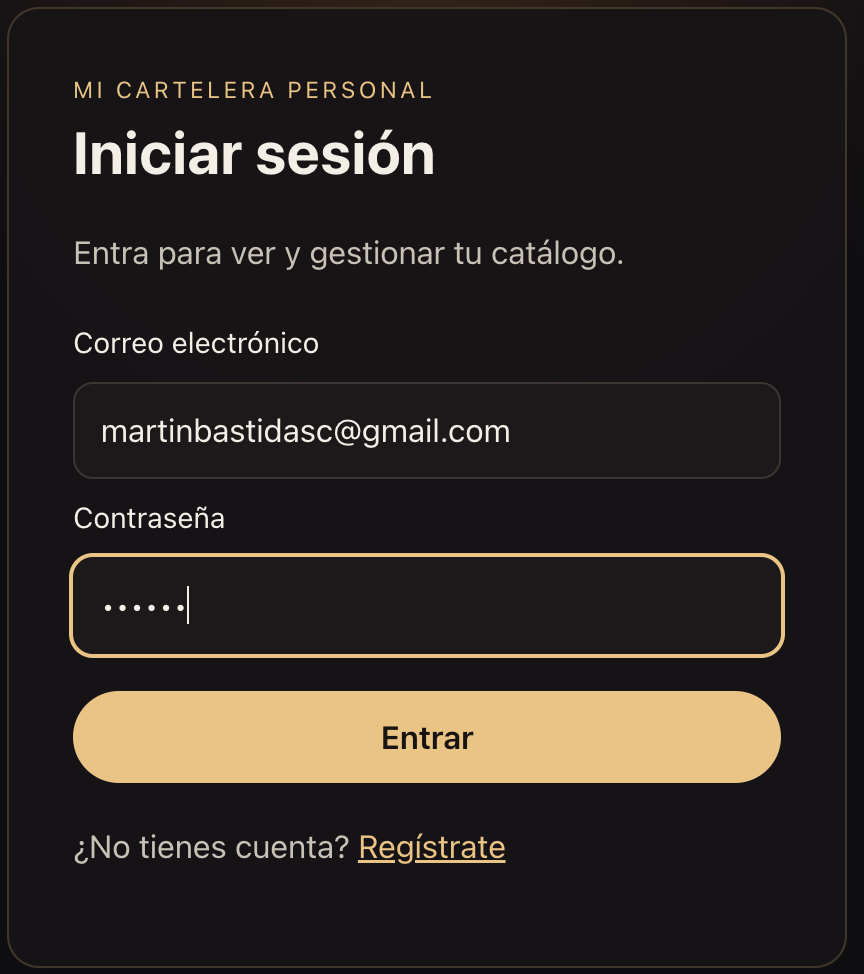
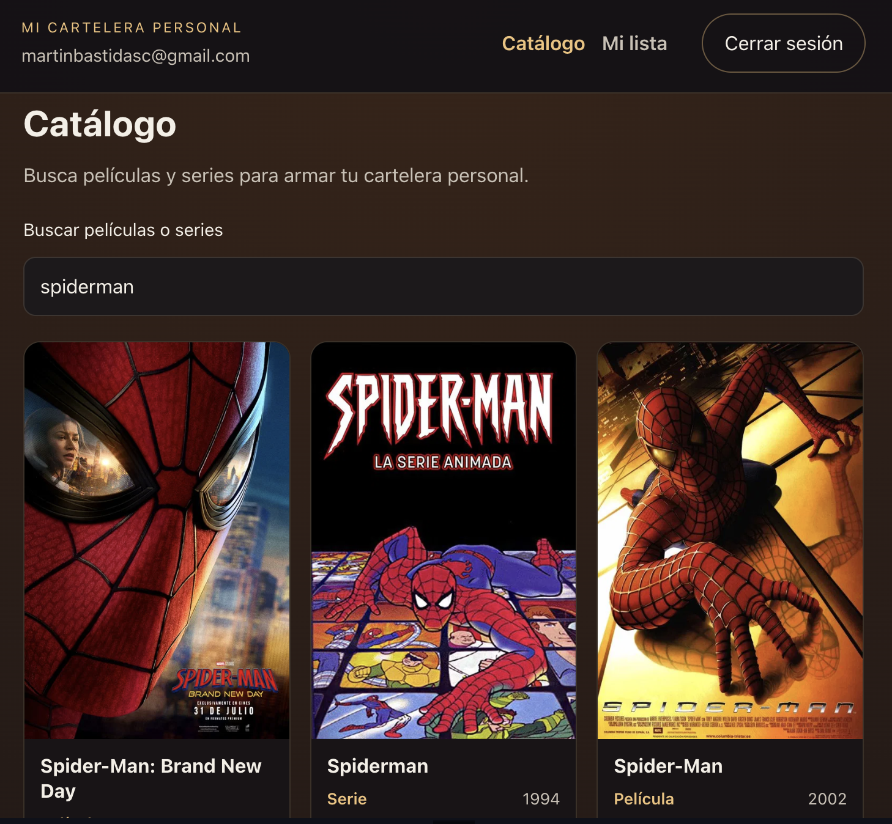
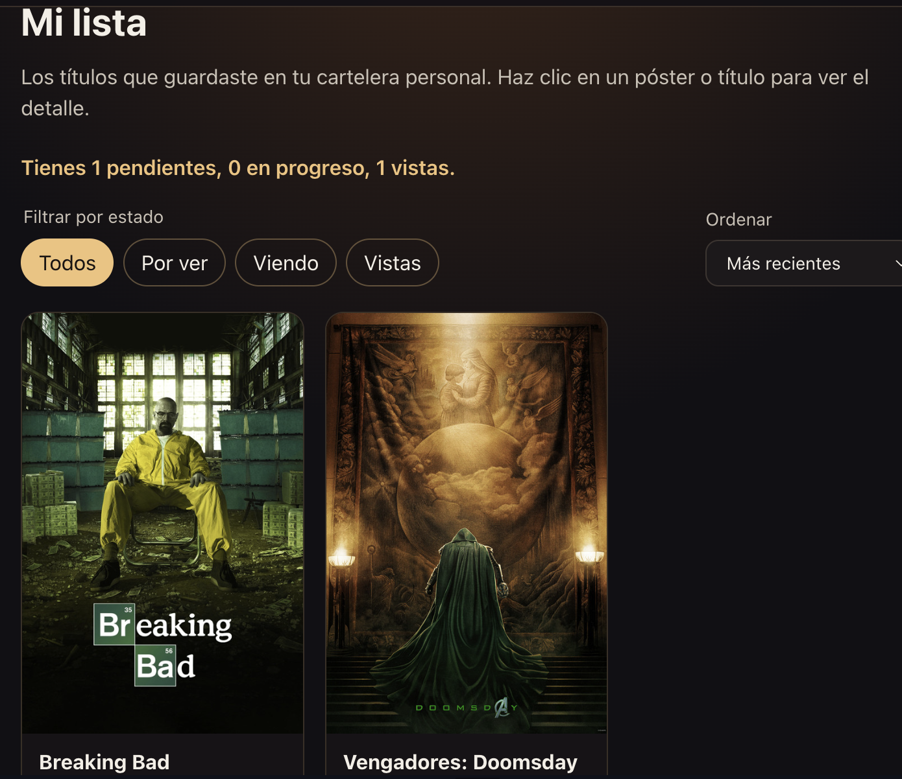
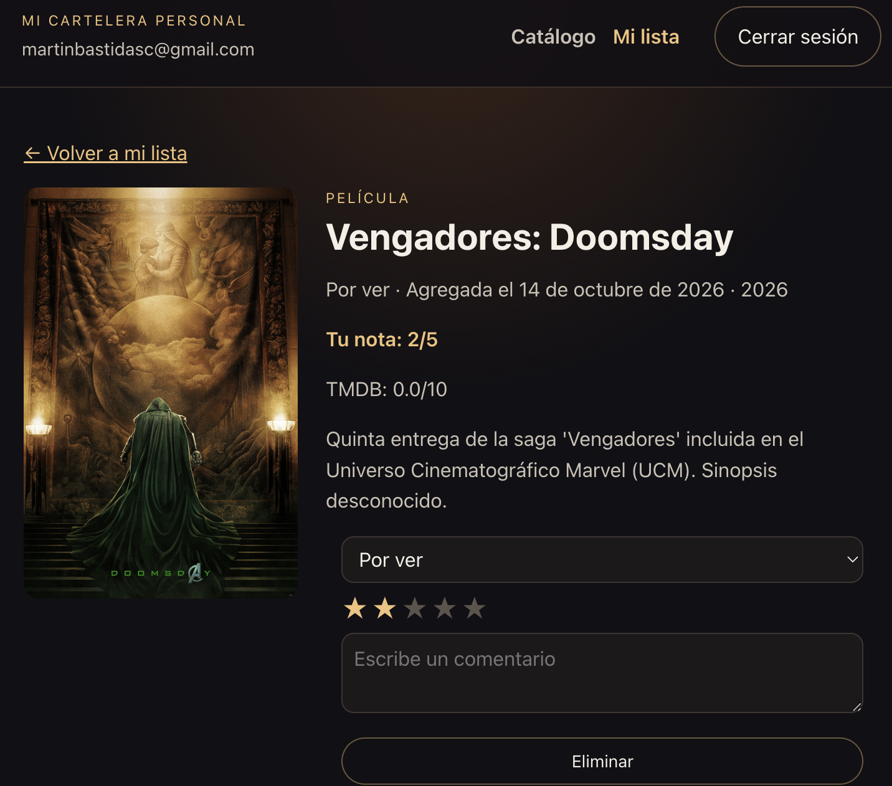

# Mi Cartelera Personal · Entregable 4

Evolución del Proyecto 3: aplicación React + TypeScript + Vite para explorar películas/series en TMDB, mantener la lista personal en Supabase y ahora **crear sesiones «Noche de película»** con el tiempo libre real del usuario.

**Autor original del Proyecto 3:** Martín Bastidas. **Evolución E2:** implementación asistida; las comprobaciones que dependen de cuentas y del navegador deben completarse con los resultados reales del estudiante.

## Funciones que permanecen (E1)

- Registro, login, cierre de sesión y rutas protegidas.
- Buscar películas y series en TMDB, guardar en `mi_lista`.
- Marcar `por_ver` / `viendo` / `vista`, editar comentarios y calificaciones.
- Filtrar, ordenar, consultar detalles y eliminar títulos.

## Noche de película (E2)

En la navegación, entra a **Noche de película** (`/noche-de-pelicula`):

1. Introduce un tiempo disponible **entero de 30 a 600 minutos**.
2. Mira tus películas **por ver**, ordenadas de menor a mayor duración, obtenida mediante `/movie/{id}` de TMDB. Las series no aparecen.
3. Añade películas a la sesión; se calculan **10 minutos de pausa entre películas**, sin pausa para una película única. El límite exacto cabe. Las duraciones desconocidas/no disponibles se explican, y los errores de TMDB se pueden reintentar.
4. Observa siempre duración total y minutos restantes. Si te pasas, no permite añadir más ni guardar.
5. Escribe un nombre y pulsa **Guardar mi noche**. El plan queda en Supabase con snapshot de títulos/duraciones, fecha y usuario. Los títulos **siguen «por ver»**. Puedes repetir una película en otra noche, pero no dos veces en la misma.
6. Abre **Mis sesiones guardadas** y despliega los detalles; un plan guardado no se edita y no desaparece por eliminar después un título de la lista.

## Requisitos

- Node.js 22.6+ recomendado (Node 24 funciona), npm.
- Cuenta Supabase con Auth habilitada y dos usuarios para prueba RLS.
- API key de **TMDB** para el cliente; la documentación pública: https://developer.themoviedb.org/reference/movie-details.

## Instalación y ejecución local (Mac / Windows / Linux)

```bash
npm install
cp .env.example .env
```

Rellena `.env` **solo localmente**:

```dotenv
VITE_SUPABASE_URL=https://tu-proyecto.supabase.co
VITE_SUPABASE_ANON_KEY=tu_clave_anon_publica
VITE_TMDB_API_KEY=tu_clave_de_tmdb
```

Usa tu archivo `.env` local del Proyecto 3 para conservar la conexión, o configura un proyecto nuevo. **El ZIP entregado no contiene `.env` ni claves privadas**. Nunca añadas `service_role`, passwords ni access tokens a `VITE_*`: la app Vite expone sus variables al navegador.

En el **SQL Editor de Supabase**, aplica en orden, si no estaban aplicadas:

1. `supabase/migrations/001_mi_lista.sql` — base del Proyecto 3; **si ya se ejecutó, no repetir** por sus políticas.
2. `supabase/migrations/002_noche_pelicula.sql` — tabla de sesiones, RLS de lectura y función RPC segura de guardado.

Después:

```bash
npm run dev
npm run test
npm run build
```

El servidor local de Vite indicará su URL (generalmente `http://localhost:5173`). Para una comprobación del dominio **sin instalar Vitest** en Node 22+: `npm run test:offline`.

> **Instalación en esta entrega:** Bootstrap 5.3 se incluye como hoja MIT local en `src/vendor/bootstrap.min.css` (sin dependencia externa en tiempo de ejecución). Vitest y Prettier se añaden al manifiesto para instalar con `npm install`. Si tu copia anterior tiene dependencias instaladas en macOS, instala de nuevo en tu máquina en lugar de copiarlas entre plataformas. `npm install` también actualiza `package-lock.json` si la versión local del lock difiere de `package.json`.

## Scripts

| Comando | Resultado |
| --- | --- |
| `npm run dev` | Abre el servidor Vite |
| `npm run build` | TypeScript estricto + build Vite |
| `npm run test` | Suite Vitest (reglas puras) |
| `npm run test:watch` | Tests en desarrollo |
| `npm run test:offline` | 21 comprobaciones puras con Node (sin conexión) |
| `npm run format` | Prettier para código y documentos |
| `npm run preview` | Previsualiza el build |

## Documentación y harness

- `AGENTS.md` (menos de 40 líneas; **ninguna funcionalidad sin spec**, reglas de claves, commits).
- `CLAUDE.md` importa `@AGENTS.md`.
- `.claude/skills/commit/SKILL.md` define `/commit` con `disable-model-invocation`.
- `.claude/settings.json` ejecuta el hook `PostToolUse` que formatea con Prettier archivos editados cuando está instalado.
- `docs/ESTADO-INICIAL.md` revisa E1, stack y deuda.
- `docs/prd/PRD.md` define las épicas E1/E2 sin detalle técnico.
- `docs/backlog/` contiene historias, criterios, casos borde y tickets.
- `docs/specs/NOCHE-DE-PELICULA.md` detalla contratos, datos, seguridad y trazabilidad.
- `DESIGN.md` y `docs/diseno/brand-board.html` contienen el sistema de diseño Bootstrap + tema heredado.
- `docs/VERIFICACION.md`, `docs/AUDITORIA.md` y `docs/PRUEBA-RLS.md` muestran pruebas realizadas y pasos pendientes con evidencia.
- `docs/CHECKPOINTS.md` contiene los hashes locales para checkpoints.

## Seguridad y notas de entrega

El navegador **no tiene privilegio de escritura directa** en `sesiones_noche`. Solo puede listar sesiones propias por RLS y guardar mediante `guardar_noche` (valida usuario, lista, estado, runtime y tiempo). Las duraciones se reciben del cliente y se recalcula el total en SQL; no existe un proceso servidor que consulte TMDB para comprobar que el runtime no fue manipulado (límite registrado en la spec).

El código, pruebas puras y SQL están preparados. **Desde este entorno no se pudo aplicar la migración a tu Supabase, entrar con dos cuentas ni certificar el funcionamiento real en el navegador.** Sigue `docs/PRUEBA-RLS.md` y llena resultados manuales en `docs/VERIFICACION.md` antes de subir a D2L. El historial conserva el Proyecto 3 y registra documentos antes de código E2; subir los commits a tu repositorio y adjuntar enlaces de checkpoint requiere Git remoto desde tu equipo.

## Capturas de E1





