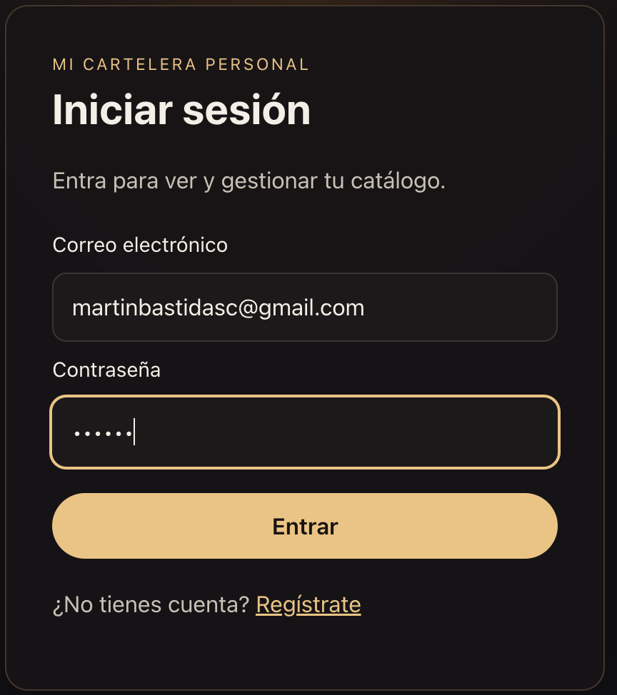
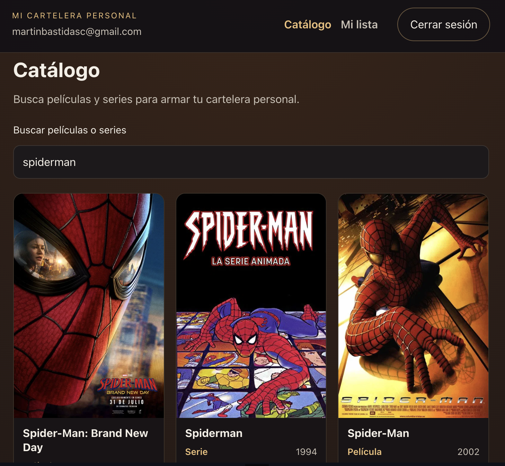
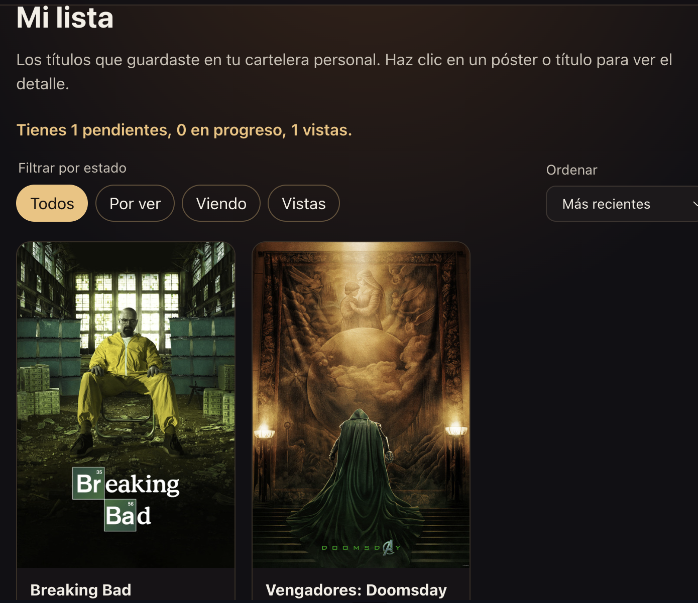
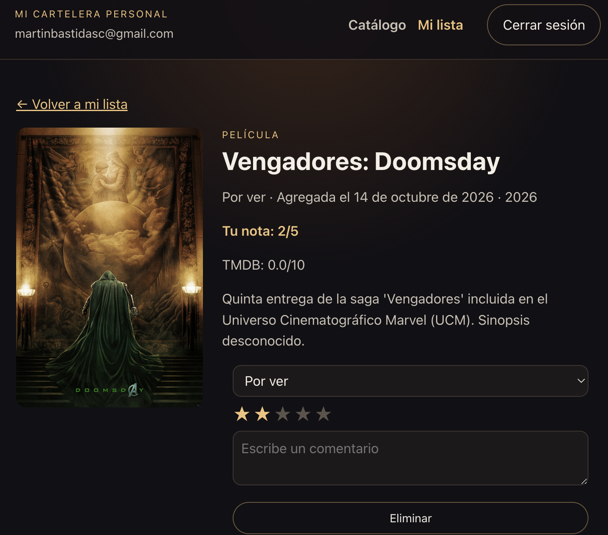

# Mi Cartelera Personal

Aplicación React + TypeScript (Vite) para buscar películas y series en TMDB, guardarlas en Supabase y gestionar tu lista (por ver, viendo, vista).

## Requisitos

- Node.js 20 o superior
- Un proyecto en [Supabase](https://supabase.com)
- Una API key de [The Movie Database](https://www.themoviedb.org/settings/api)

## Instalación

```bash
npm install
cp .env.example .env


```
VITE_SUPABASE_URL=https://tu-proyecto.supabase.co
VITE_SUPABASE_ANON_KEY=tu_anon_key
VITE_TMDB_API_KEY=tu_tmdb_api_key
```

En el cliente **solo** van la URL, la **anon key** de Supabase y la API key de TMDB. Nunca uses la `service_role` en el frontend.

## Base de datos

En el dashboard de Supabase abre **SQL Editor** y ejecuta `supabase/migrations/001_mi_lista.sql`. Eso crea la tabla `mi_lista` y las políticas RLS para que cada usuario solo vea y edite sus filas.

## Uso

```bash
npm run dev
```

1. Crea una cuenta o inicia sesión (`/registro`, `/login`).
2. En **Catálogo** busca un título y pulsa **Agregar a mi lista**.
3. En **Mi lista** filtra por estado, ordena por fecha o calificación y revisa el resumen de pendientes / en progreso / vistas.
4. Haz clic en el póster o el título para abrir la **página de detalle**.

## Scripts

| Comando | Descripción |
| --- | --- |
| `npm run dev` | Servidor de desarrollo |
| `npm run build` | Typecheck y build de producción |
| `npm run preview` | Previsualiza el build |

## 📸 Capturas de Pantalla

### 1. Pantalla de Login


### 2. Buscador de TMDB


### 3. Mi Lista Personal


### 4. Página de Detalle


👤 Autor
Desarrollado por Martín Bastidas.
