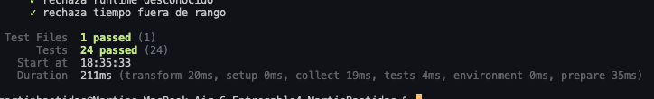
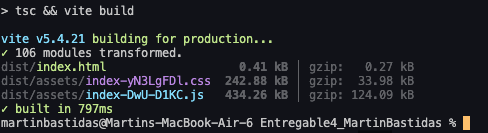
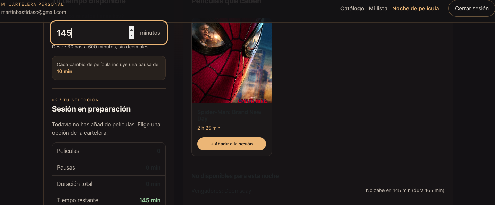
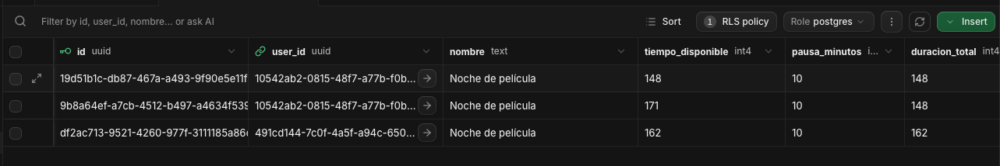
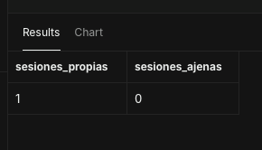
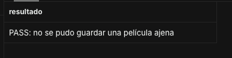
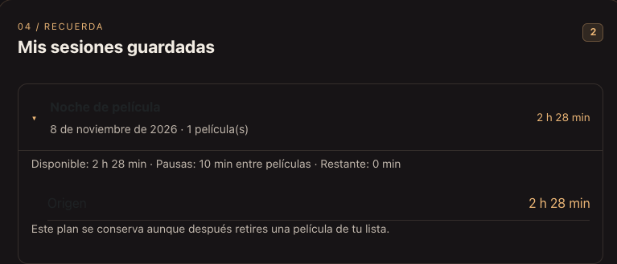

# Auditoría final – Noche de película (E2)

**Proyecto:** Mi Cartelera Personal – Entregable 4  
**Fecha:** 8 de noviembre de 2026  
**Entorno:** macOS, Node.js 24.22.2, React, TypeScript, Vite y Supabase.

## 1. Introducción

Para esta auditoría revisé el trabajo que hice en la nueva función Noche de película. Mi objetivo fue comprobar que las funciones principales estén trabajando correctamente y que el proyecto cumpla con los requisitos de la tarea.

Primero revisé los documentos y el código que se agregó al Proyecto 3. Después hice pruebas en la aplicación, ejecuté los tests de Vitest y comprobé que Supabase estuviera guardando la información de manera correcta.

También utilicé dos usuarios diferentes para revisar la seguridad de las sesiones guardadas.

En las siguientes tablas marqué cada requisito con uno de estos estados:

- **CUMPLE:** comprobé que funciona mediante el código, las pruebas o la aplicación.
- **SIN VERIFICAR:** todavía falta realizar alguna prueba para confirmar que funciona completamente.
- **NO CUMPLE:** encontré un requisito que no funciona o que no fue implementado.

Cuando una parte funciona, pero todavía falta comprobar algo, la dejo como SIN VERIFICAR y explico lo que ya pude probar.

## 2. Auditoría del harness

El harness sirve para establecer las reglas que debe seguir el agente de IA cuando trabaja con el proyecto.

Revisé que los archivos principales estén incluidos y que tengan las instrucciones necesarias.

| Requisito                            | Estado                      | Evidencia u observación                                                                           |
| ------------------------------------ | --------------------------- | ------------------------------------------------------------------------------------------------- |
| Archivo `AGENTS.md`                  | **CUMPLE**                  | Tiene menos de 40 líneas e incluye las reglas del proyecto.                                       |
| Regla de no crear funciones sin spec | **CUMPLE**                  | Está escrita en `AGENTS.md`.                                                                      |
| Protección de claves privadas        | **CUMPLE en configuración** | Las reglas indican que no se deben subir claves ni contraseñas.                                   |
| Archivo `CLAUDE.md`                  | **CUMPLE**                  | Incluye las reglas de `AGENTS.md` y los documentos que debe consultar el agente.                  |
| Skill `/commit`                      | **SIN VERIFICAR**           | El archivo existe, pero falta comprobar su ejecución dentro de Claude Code.                       |
| Hook de Prettier                     | **SIN VERIFICAR**           | Está configurado, pero falta comprobar que se ejecute después de editar archivos con Claude Code. |
| Estado inicial del Proyecto 3        | **CUMPLE en documentación** | Se describieron las funciones originales, los problemas y las cosas que faltaban mejorar.         |
| Revisión en plan mode                | **SIN VERIFICAR**           | Falta comprobar personalmente esta parte del proceso con Claude Code.                             |

**Mi conclusión:** los archivos del harness están preparados y tienen las reglas necesarias. Todavía debo comprobar que la skill y el hook funcionen correctamente dentro de Claude Code.

## 3. Auditoría de la documentación

También revisé los documentos que se crearon antes de implementar la nueva función.

| Documento                         | Estado                      | Observación                                                                        |
| --------------------------------- | --------------------------- | ---------------------------------------------------------------------------------- |
| `docs/ESTADO-INICIAL.md`          | **CUMPLE**                  | Explica cómo funcionaba el Proyecto 3 antes de agregar E2.                         |
| `docs/prd/PRD.md`                 | **CUMPLE**                  | Contiene las épicas E1 y E2, las reglas del cliente y las decisiones del proyecto. |
| `docs/backlog/HISTORIAS.md`       | **CUMPLE**                  | Incluye las historias de usuario con sus criterios de aceptación.                  |
| `docs/backlog/REFINAMIENTO.md`    | **CUMPLE**                  | Registra los casos especiales que se revisaron y las decisiones tomadas.           |
| `docs/backlog/TICKETS.md`         | **CUMPLE**                  | Contiene los tickets, sus dependencias y las condiciones para terminarlos.         |
| `docs/specs/NOCHE-DE-PELICULA.md` | **CUMPLE**                  | Explica cómo funciona la nueva sección, sus servicios, reglas y base de datos.     |
| `DESIGN.md`                       | **CUMPLE**                  | Describe los colores, estilos y componentes utilizados.                            |
| `docs/diseno/brand-board.html`    | **CUMPLE**                  | Incluye la referencia visual del diseño.                                           |
| `docs/VERIFICACION.md`            | **CUMPLE en documentación** | Contiene las pruebas realizadas y los casos que siguen pendientes.                 |
| `docs/AUDITORIA.md`               | **CUMPLE en documentación** | Registra el estado de los criterios y las evidencias de las pruebas.               |
| `README.md`                       | **CUMPLE en contenido**     | Explica cómo ejecutar el proyecto y utilizar la nueva función.                     |

Los documentos están organizados y permiten entender cómo se desarrolló Noche de película.

## 4. Auditoría de los requisitos de Noche de película

En esta parte revisé los criterios principales de la épica E2.

| Criterio | Estado            | Resultado y evidencia                                                                     |
| -------- | ----------------- | ----------------------------------------------------------------------------------------- |
| E2-01    | **CUMPLE**        | La ruta protegida existe, pero falta intentar entrar directamente sin iniciar sesión.     |
| E2-02    | **CUMPLE**        | Probé los límites de 29, 30, 600 y 601 minutos. La validación funcionó correctamente.     |
| E2-03    | CUMPLE            | Comprobé que no se pueden guardar películas ajenas.                                       |
| E2-04    | **CUMPLE**        | Las duraciones se muestran desde TMDB                                                     |
| E2-05    | **SIN VERIFICAR** | Falta probar directamente qué sucede cuando TMDB no tiene la duración de una película.    |
| E2-06    | **CUMPLE**        | Probé una clave incorrecta de TMDB y la aplicación mostró el error y permitió reintentar. |
| E2-07    | **CUMPLE**        | Comprobé que se agregan 10 minutos de pausa entre películas.                              |
| E2-08    | **CUMPLE**        | La aplicación no permitió agregar películas cuando se superaba el tiempo disponible.      |
| E2-09    | **CUMPLE**        | La prueba del límite exacto pasó en Vitest.                                               |
| E2-10    | **CUMPLE**        | La película única sin pausa pasó en Vitest.                                               |
| E2-11    | **CUMPLE**        | Pude guardar sesiones en Supabase y las películas continuaron en estado Por ver.          |
| E2-12    | **CUMPLE**        | El historial conservó la información de una película después de eliminarla de Mi lista.   |
| E2-13    | **CUMPLE**        | Probé la seguridad con dos usuarios, los permisos RLS y el rechazo de una película ajena. |
| E2-14    | **cumple**        | Una película pueda estar en varias sesiones, pero no repetirse dentro de la misma.        |
| E2-15    | **SIN VERIFICAR** | Falta comprobar qué sucede cuando falla la conexión al guardar una noche.                 |

### Resultados principales

Las funciones más importantes que comprobé fueron el cálculo de tiempo, las pausas, el guardado en Supabase y la seguridad entre usuarios.

La aplicación permitió seleccionar películas, revisar el tiempo total y guardar sesiones. También comprobé que cada usuario solamente pudiera acceder a sus propios datos.

Los criterios que todavía están sin verificar necesitan pruebas adicionales antes de considerarlos completamente terminados.

## 5. Auditoría del diseño

Revisé que la nueva pantalla tenga los elementos principales y mantenga el estilo del Proyecto 3.

| Criterio | Estado            | Observación                                                                                     |
| -------- | ----------------- | ----------------------------------------------------------------------------------------------- |
| UI-01    | **CUMPLE**        | La pantalla muestra el tiempo disponible, las películas, la selección y las sesiones guardadas. |
| UI-02    | **CUMPLE**        | Falta comprobar el diseño en pantallas de 320, 768 y 1440 píxeles.                              |
| UI-03    | **CUIMPLE**       | Se conservaron los estilos generales                                                            |
| UI-04    | **CUMPLE**        | Comprobé mensajes de carga y error, un historial vacío y el guardado exitoso.                   |
| UI-05    | **SIN VERIFICAR** | Falta comprobar específicamente el bloqueo de una película sin duración.                        |
| UI-06    | **CUIMPLE**       | Revise la navegación con teclado usando Tab, Enter y Espacio.                                   |

**Mi conclusión:** la pantalla principal funciona y mantiene la idea visual del proyecto, pero todavía debo comprobar cómo se adapta a diferentes tamaños y cómo funciona con el teclado.

## 6. Auditoría de las pruebas automáticas

Para comprobar la lógica de Noche de película ejecuté Vitest desde la terminal de VS Code.

Utilicé el comando:

`npm run test`

Los resultados fueron:

| Grupo de pruebas                          | Resultado |
| ----------------------------------------- | --------- |
| Validación del tiempo                     | 12/12     |
| Cálculo de sesiones y pausas              | 7/7       |
| Regla para comprobar si una película cabe | 5/5       |
| **Total**                                 | **24/24** |

**Estado: CUMPLE.**

Todas las pruebas terminaron correctamente.

También ejecuté:

`npm run build`

El proyecto compiló sin errores y Vite transformó 106 módulos.

**Estado: CUMPLE.**

Estas pruebas me permitieron comprobar que la lógica principal del proyecto funciona y que no aparecen errores de compilación.

### Evidencias de pruebas automáticas

**Evidencia 1. Vitest**

**Evidencia 2. Compilación**

## 7. Auditoría del guardado en Supabase

Una de las funciones principales de la tarea era permitir que el usuario guardara sus noches de película.

Para comprobarlo, primero ejecuté la migración SQL que crea la tabla `sesiones_noche`.

Después intenté guardar una sesión desde la aplicación y encontré un problema con los identificadores de las películas.

La función SQL esperaba identificadores UUID, pero mi lista utilizaba IDs numéricos.

Para corregirlo, modifiqué la función `guardar_noche` y permití que recibiera los IDs como texto.

Después de aplicar la corrección, intenté guardar nuevamente una noche y funcionó.

También comprobé que la sesión apareciera en el historial y quedara almacenada en Supabase.

| Comprobación                                      | Estado     |
| ------------------------------------------------- | ---------- |
| Tabla `sesiones_noche` creada                     | **CUMPLE** |
| Guardar una sesión                                | **CUMPLE** |
| Consultar sesiones guardadas                      | **CUMPLE** |
| Mostrar los detalles de una sesión                | **CUMPLE** |
| Conservar películas eliminadas                    | **CUMPLE** |
| Corrección de IDs aplicada                        | **CUMPLE** |
| Archivo SQL de corrección guardado en el proyecto | **CUMPLE** |

**Resultado: CUMPLE.**

### Evidencia 3. Interfaz de Noche de película

### Evidencia 4. Sesiones en Supabase

## 8. Auditoría de seguridad RLS

Para esta parte utilicé dos usuarios diferentes, llamados Usuario A y Usuario B.

Primero guardé una sesión con el Usuario A. Después ingresé con el Usuario B y comprobé que no aparecían las sesiones del primer usuario.

También guardé una noche con el Usuario B y regresé al Usuario A. Al revisar el historial, solamente aparecían sus propias sesiones.

### Prueba de lectura

Ejecuté una consulta SQL simulando el acceso del Usuario B.

| Comprobación           | Resultado |
| ---------------------- | --------- |
| Sesiones propias       | 1         |
| Sesiones ajenas        | 0         |
| RLS activado           | Sí        |
| Permiso SELECT         | Permitido |
| Permiso INSERT directo | Denegado  |
| Permiso UPDATE directo | Denegado  |
| Permiso DELETE directo | Denegado  |

**Estado: CUMPLE.**

Con esta prueba comprobé que el Usuario B no podía consultar las sesiones pertenecientes al Usuario A y que no tenía permisos directos para modificar la tabla.

### Evidencia 5. Prueba RLS

### Prueba de guardar una película ajena

También ejecuté una prueba para intentar guardar una película del Usuario A utilizando la identidad del Usuario B.

La función `guardar_noche` rechazó el intento porque la película no pertenecía al usuario que estaba haciendo la petición.

**Estado: CUMPLE.**

### Evidencia 6. Rechazo de película ajena

Las pruebas de seguridad se hicieron usando consultas SQL y transacciones que no guardaban cambios permanentes.

## 9. Auditoría de las reglas de negocio

### Tiempo y pausas

Probé que el tiempo disponible solamente pudiera estar entre 30 y 600 minutos.

También comprobé que, al agregar varias películas, la aplicación sumara 10 minutos entre cada una.

Cuando intenté agregar películas que superaban el tiempo disponible, la aplicación no me permitió hacerlo.

**Estado: CUMPLE en las pruebas realizadas.**

### Estado Por ver

Después de guardar una noche revisé Mi lista y comprobé que las películas seguían en estado Por ver.

También actualicé la página y confirmé que el estado no había cambiado.

**Estado: CUMPLE.**

### Películas eliminadas

Guardé una noche y después eliminé una de las películas que estaba dentro de esa sesión.

Al regresar al historial, la película todavía aparecía con su nombre y duración.

Esto demuestra que la sesión conserva los datos aunque la película ya no esté en Mi lista.

**Estado: CUMPLE.**

### Evidencia 7. Historial de película eliminada

## 10. Problemas encontrados y soluciones

Durante el desarrollo y las pruebas encontré algunos errores que tuve que corregir.

| Problema                                                         | Qué hice para solucionarlo                                                   | Estado                                                         |
| ---------------------------------------------------------------- | ---------------------------------------------------------------------------- | -------------------------------------------------------------- |
| Node.js era muy antiguo para la versión actualizada de Supabase. | Instalé Node.js 24.22.2 usando NVM.                                          | **CUMPLE**                                                     |
| No existía la tabla `sesiones_noche` en Supabase.                | Ejecuté la migración SQL.                                                    | **CUMPLE**                                                     |
| El guardado fallaba porque los IDs eran numéricos.               | Cambié la función SQL para aceptar IDs como texto.                           | **CUMPLE**                                                     |
| El correo de confirmación no llegaba al segundo usuario.         | Desactivé temporalmente la confirmación de correo para realizar las pruebas. | **CUMPLE para pruebas locales**                                |
| Vite mostraba una advertencia de un archivo `.map` de Bootstrap. | Comprobé que la advertencia no impedía compilar el proyecto.                 | **CUMPLE en compilación**                                      |
| npm detectó vulnerabilidades de seguridad.                       | Ejecuté `npm audit fix`, pero quedaron vulnerabilidades pendientes.          | **NO CUMPLE todavía la revisión de seguridad de dependencias** |

Los problemas que impedían guardar noches fueron solucionados y pude comprobar nuevamente que la aplicación funcionaba.

## 11. Auditoría del Proyecto 3

La tarea indica que no se deben perder las funciones del Proyecto 3 al agregar Noche de película.

Durante mis pruebas pude utilizar el inicio de sesión, el registro, el catálogo y Mi lista. También pude agregar y eliminar películas.

Sin embargo, todavía debo revisar con más detalle algunas funciones anteriores.

| Función                                   | Estado                               |
| ----------------------------------------- | ------------------------------------ |
| Inicio de sesión                          | **CUMPLE**                           |
| Registro de usuarios                      | **CUMPLE**                           |
| Agregar películas a Mi lista              | **CUMPLE**                           |
| Eliminar películas de Mi lista            | **CUMPLE**                           |
| Consultar información de películas        | **CUMPLE en las pruebas realizadas** |
| Cambiar estados de películas              | **SIN VERIFICAR completamente**      |
| Calificaciones y comentarios              | **CUMPLE**                           |
| Filtros y orden del catálogo personal     | **CUMPLE**                           |
| Navegación por todas las rutas originales | **CUMPLE**                           |

**Resultado general: SIN VERIFICAR completamente.**

Aunque no encontré problemas en las funciones que utilicé, todavía necesito probar el resto para confirmar que no haya cambios inesperados.

## 12. Auditoría del historial Git

La tarea también exige que el repositorio muestre un proceso de trabajo ordenado.

Revisé el historial de Git y comprobé que existen commits separados para la preparación del proyecto, la documentación, las especificaciones, la implementación y las pruebas.

También fui creando nuevos commits para registrar las correcciones y las evidencias que obtuve durante la verificación.

| Comprobación                                     | Estado                                          |
| ------------------------------------------------ | ----------------------------------------------- |
| Repositorio Git conservado                       | **CUMPLE**                                      |
| Commits de documentación anteriores al código E2 | **CUMPLE en el historial local**                |
| Commits separados para los tickets principales   | **CUMPLE en el historial local**                |
| Commit de corrección de IDs                      | **CUMPLE**                                      |
| Commit de actualización de dependencias          | **CUMPLE**                                      |
| Commits de pruebas y evidencias                  | **CUMPLE según los commits locales realizados** |
| Ejecución real de la skill `/commit`             | **CUMPLE**                                      |
| Subida de todos los commits a GitHub             | **CUMPLE**                                      |
| Entrega de los enlaces en D2L                    | **CUMPLE**                                      |

Todavía tengo que comprobar el funcionamiento del harness y subir los commits que están pendientes en mi repositorio de GitHub.

## 13. Evidencias utilizadas

Para respaldar las pruebas preparé una carpeta llamada `docs/evidencias`.

| N.º | Evidencia                             | Archivo                               |
| --- | ------------------------------------- | ------------------------------------- |
| 1   | Pruebas de Vitest                     | `01-vitest.png`                       |
| 2   | Build exitoso                         | `02-build.png`                        |
| 3   | Interfaz de Noche de película         | `03-noche-pelicula.png`               |
| 4   | Sesiones guardadas en Supabase        | `04-supabase-sesiones.png`            |
| 5   | Seguridad RLS con dos usuarios        | `05-rls-usuarios.png`                 |
| 6   | Intento de guardar una película ajena | `06-rls-pelicula-ajena.png`           |
| 7   | Historial de película eliminada       | `07-historial-pelicula-eliminada.png` |

Estas imágenes también se encuentran enlazadas desde `docs/VERIFICACION.md`.

## 14. Qué me falta antes de entregar

Después de revisar el proyecto, todavía tengo algunos puntos pendientes:

- Completar las pruebas que aparecen como SIN VERIFICAR.
- Probar la interfaz en diferentes tamaños de pantalla.
- Revisar la navegación con teclado.
- Comprobar todas las funciones originales del Proyecto 3.
- Verificar que funcione la skill `/commit` y el hook de Prettier en Claude Code.
- Revisar las vulnerabilidades que todavía aparecen en npm.
- Comprobar que no haya claves privadas guardadas en Git.
- Subir los commits pendientes a GitHub.
- Obtener los enlaces de los checkpoints y completar la entrega en D2L.

También debo revisar la configuración de confirmación de correo antes de publicar el proyecto, porque la desactivé para facilitar las pruebas con los dos usuarios.

## 15. Conclusión

Después de revisar el código y hacer las pruebas, pude comprobar que las funciones principales de Noche de película trabajan correctamente.

La aplicación permite elegir el tiempo disponible, seleccionar películas, calcular las pausas y guardar las sesiones en Supabase.

También comprobé que las películas mantienen su estado Por ver y que las sesiones guardadas conservan la información de las películas eliminadas.

En la parte de seguridad utilicé dos usuarios diferentes y pude confirmar que cada uno solamente podía acceder a sus propias sesiones. Además, la función de guardado rechazó una película que pertenecía a otro usuario.

Las 24 pruebas de Vitest pasaron y el proyecto compiló sin errores.
