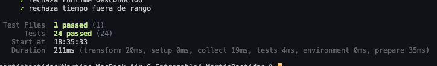
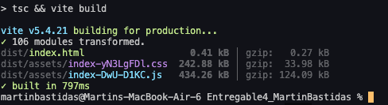
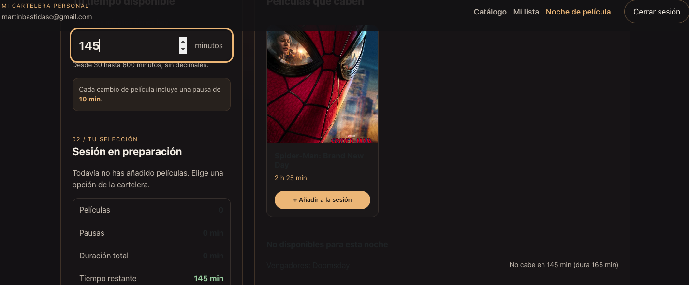
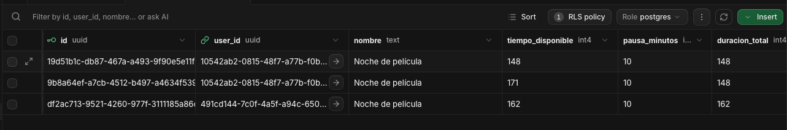
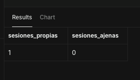
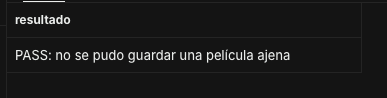
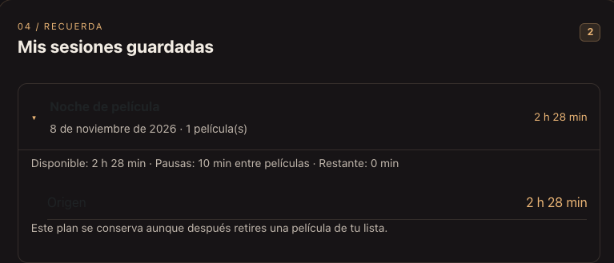

# Verificación de E2 – Noche de película

**Proyecto:** Mi Cartelera Personal – Entregable 4  
**Fecha:** 8 de noviembre de 2026  
**Entorno:** macOS, Node.js 24.22.2, Vite 5.4.21 y Supabase.

## 1. Introducción

Para comprobar que la nueva función Noche de película trabaja correctamente, realicé varias pruebas en mi computadora, en la aplicación y en Supabase.

Lo que quería comprobar era que los usuarios pudieran elegir cuánto tiempo tienen disponible, seleccionar películas que entren en ese tiempo y guardar sus noches sin problemas.

También revisé que los cálculos fueran correctos, que las películas mantuvieran su estado y que cada usuario solamente pudiera ver sus propias sesiones.

En este documento muestro las pruebas que realicé, los resultados que obtuve y algunos errores que encontré durante el proceso.

Las pruebas que todavía no he realizado están marcadas como **SIN VERIFICAR**.

## 2. Pruebas técnicas

Primero comprobé que el proyecto pudiera instalarse, ejecutarse y compilar sin errores.

| Prueba                             | Resultado obtenido | Observaciones                                                                                                  |
| ---------------------------------- | ------------------ | -------------------------------------------------------------------------------------------------------------- |
| `npm install`                      | **PASS**           | Las dependencias se instalaron correctamente.                                                                  |
| `node -v`                          | **PASS**           | Utilicé Node.js 24.22.2.                                                                                       |
| `npm run test`                     | **PASS**           | Pasaron las 24 pruebas de Vitest.                                                                              |
| `npm run build`                    | **PASS**           | El proyecto compiló correctamente.                                                                             |
| `npm run dev`                      | **PASS**           | La aplicación inició en localhost.                                                                             |
| Conexión con Supabase              | **PASS**           | Pude iniciar sesión y guardar información.                                                                     |
| Migración SQL de Noche de película | **PASS**           | Se creó la tabla para guardar las sesiones.                                                                    |
| Corrección de IDs                  | **PASS**           | Se solucionó el error al guardar películas con IDs numéricos.                                                  |
| Funciones del Proyecto 3           | **PARCIAL**        | Las funciones utilizadas durante las pruebas siguen funcionando, pero falta revisar todo el proyecto anterior. |

### Pruebas con Vitest

Ejecuté el comando:

`npm run test`

El resultado fue de **24 pruebas aprobadas de 24**.

| Grupo de pruebas                        | Resultado |
| --------------------------------------- | --------- |
| Validación del tiempo disponible        | 12/12     |
| Cálculo de sesiones y pausas            | 7/7       |
| Regla para comprobar si una sesión cabe | 5/5       |
| **Total**                               | **24/24** |

Con estas pruebas comprobé que los cálculos funcionan correctamente, incluyendo los límites de tiempo, las pausas y las películas sin duración válida.

**Resultado: PASS.**

### Evidencia 1. Pruebas de Vitest

En esta captura se puede ver que todas las pruebas terminaron correctamente.

### Compilación del proyecto

Después ejecuté:

`npm run build`

La compilación terminó correctamente, sin errores de TypeScript, y Vite transformó 106 módulos.

**Resultado: PASS.**

### Evidencia 2. Build exitoso

Esta captura muestra el resultado de la compilación desde la terminal de VS Code.

## 3. Verificación funcional V01–V21

En esta parte revisé los criterios de la nueva función Noche de película. Algunas pruebas las hice directamente en la aplicación y otras con Vitest o Supabase.

| ID  | Prueba                                                                               | Resultado obtenido                                                                                                             |
| --- | ------------------------------------------------------------------------------------ | ------------------------------------------------------------------------------------------------------------------------------ |
| V01 | Entrar a Noche de película sin iniciar sesión.                                       | **SIN VERIFICAR.** La protección está en el código, pero falta comprobarla desde el navegador.                                 |
| V02 | Probar tiempos de 29, 30, 600 y 601 minutos.                                         | **PASS.** Los cuatro valores se validaron correctamente.                                                                       |
| V03 | Comprobar que solo se utilicen películas propias en estado Por ver.                  | **PARCIAL.** Se comprobó que no se pueden guardar películas de otro usuario, pero falta probar todos los estados y las series. |
| V04 | Revisar el orden de las películas y sus duraciones.                                  | **SIN VERIFICAR.** Falta comparar varios títulos.                                                                              |
| V05 | Revisar una película que no tenga duración.                                          | **SIN VERIFICAR.** Falta probar este caso directamente.                                                                        |
| V06 | Comprobar los estados de carga, error y recuperación de TMDB.                        | **PASS.** La aplicación mostró el error y permitió reintentar.                                                                 |
| V07 | Comprobar las pausas de 10 minutos entre películas.                                  | **PASS.** Las pausas se calcularon correctamente.                                                                              |
| V08 | Intentar agregar películas que superen el tiempo disponible.                         | **PASS.** La aplicación no permitió superar el límite.                                                                         |
| V09 | Comprobar que una sesión pueda ocupar exactamente el tiempo disponible.              | **PASS EN VITEST.** Falta probarlo manualmente con películas reales.                                                           |
| V10 | Cambiar el tiempo después de seleccionar varias películas.                           | **SIN VERIFICAR.** Falta probar este caso.                                                                                     |
| V11 | Guardar una noche y comprobar que las películas sigan en Por ver.                    | **PASS.** Las películas mantuvieron su estado.                                                                                 |
| V12 | Eliminar una película de Mi lista y revisar la sesión guardada.                      | **PASS.** La sesión conservó la película eliminada.                                                                            |
| V13 | Comprobar la seguridad entre dos usuarios.                                           | **PASS.** Cada usuario solamente pudo consultar sus sesiones y se rechazó el guardado de una película ajena.                   |
| V14 | Usar una película en varias sesiones y evitar duplicarla dentro de una misma sesión. | **SIN VERIFICAR.** Falta realizar esta prueba.                                                                                 |
| V15 | Simular un error de conexión al guardar.                                             | **SIN VERIFICAR.** Falta probar este caso.                                                                                     |
| V16 | Revisar que aparezcan las películas, el tiempo y las sesiones guardadas.             | **PASS.** Estos elementos funcionaron durante las pruebas.                                                                     |
| V17 | Probar el diseño en diferentes tamaños de pantalla.                                  | **SIN VERIFICAR.** Falta revisar los tamaños de 320, 768 y 1440 píxeles.                                                       |
| V18 | Comparar los colores y estilos con el Proyecto 3.                                    | **REVISIÓN ESTÁTICA.** Se conservaron los estilos generales, pero falta una comparación visual completa.                       |
| V19 | Comprobar los mensajes de carga, error, vacío y guardado exitoso.                    | **PARCIAL.** Se comprobaron varios estados, pero faltan otros casos.                                                           |
| V20 | Comprobar que no se pueda elegir una película sin duración.                          | **SIN VERIFICAR.** Falta una prueba específica.                                                                                |
| V21 | Probar la navegación con el teclado.                                                 | **SIN VERIFICAR.** Falta revisar Tab, Enter y Espacio.                                                                         |

## 4. Pruebas de la interfaz

### Pantalla Noche de película

Entré a la nueva sección y comprobé que podía ingresar el tiempo disponible, revisar las películas de mi lista y seleccionar cuáles quería agregar a una noche.

La aplicación mostraba cuánto duraban las películas, el tiempo total de la sesión y los minutos que quedaban disponibles.

También pude quitar películas de la selección y guardar una noche cuando el tiempo era suficiente.

**Resultado: PASS en el flujo principal.**

### Evidencia 3. Pantalla Noche de película

En esta captura se muestra la interfaz funcionando, con las películas y el cálculo del tiempo.

## 5. Pruebas de guardado en Supabase

Una de las cosas más importantes era comprobar que las noches no se guardaran solamente en la pantalla, sino también en la base de datos.

Primero ejecuté el archivo SQL de la nueva función para crear la tabla `sesiones_noche`.

Después intenté guardar una noche desde la aplicación, pero apareció un error porque los IDs de mis películas eran números y Supabase esperaba UUID.

Para solucionarlo, modifiqué la función `guardar_noche` para que pudiera trabajar con estos IDs como texto.

Luego repetí la prueba y la sesión se guardó correctamente.

También comprobé que podía cerrar sesión, volver a entrar y consultar las noches guardadas.

**Resultado: PASS.**

### Evidencia 4. Sesiones guardadas en Supabase

En esta captura se pueden ver las sesiones registradas dentro de la tabla `sesiones_noche`.

## 6. Pruebas de seguridad RLS

Para comprobar la seguridad de los datos utilicé dos cuentas diferentes, que llamé Usuario A y Usuario B.

### Prueba 1. Separación de usuarios

Primero entré con el Usuario A y guardé una noche.

Después cerré sesión y entré con el Usuario B. Al revisar sus sesiones guardadas, comprobé que no aparecían las del Usuario A.

También guardé una noche con el Usuario B y volví a entrar con el Usuario A.

Al regresar, comprobé que el Usuario A tampoco podía ver las sesiones guardadas por el Usuario B.

**Resultado: PASS.**

### Prueba 2. Comprobación de RLS en Supabase

Después hice una consulta SQL simulando que el Usuario B estaba accediendo a la base de datos.

Los resultados fueron:

| Comprobación                        | Resultado |
| ----------------------------------- | --------- |
| Sesiones propias del Usuario B      | 1         |
| Sesiones ajenas                     | 0         |
| RLS activado                        | Sí        |
| Permiso para leer                   | Permitido |
| Permiso para insertar directamente  | Denegado  |
| Permiso para modificar directamente | Denegado  |
| Permiso para eliminar directamente  | Denegado  |

Con esto comprobé que el Usuario B solamente podía leer sus sesiones y que no tenía permisos para modificar directamente la tabla.

**Resultado: PASS.**

### Evidencia 5. Seguridad RLS entre usuarios

En esta captura se muestra la consulta SQL, donde el Usuario B tiene una sesión propia y cero sesiones ajenas.

### Prueba 3. Intentar guardar una película de otro usuario

También probé qué pasaba si el Usuario B intentaba guardar una película que pertenecía al Usuario A.

Para hacerlo, ejecuté una consulta SQL que simulaba este intento usando la función `guardar_noche`.

Supabase rechazó la operación porque esa película no pertenecía al usuario que estaba intentando guardarla.

Esto me permitió comprobar que la función de guardado también revisa que las películas sean del usuario correcto.

**Resultado: PASS.**

### Evidencia 6. Intento de guardar una película ajena

En esta captura se muestra la prueba SQL que rechazó el intento de guardar una película de otro usuario.

Las pruebas SQL se realizaron utilizando transacciones con `ROLLBACK`, para evitar guardar cambios de las pruebas.

## 7. Verificación de las reglas de negocio

### Tiempo disponible

Probé diferentes valores para comprobar que el usuario solamente pueda ingresar entre 30 y 600 minutos.

Los resultados fueron:

| Tiempo ingresado | Resultado    |
| ---------------- | ------------ |
| 29 minutos       | No permitido |
| 30 minutos       | Permitido    |
| 600 minutos      | Permitido    |
| 601 minutos      | No permitido |

La aplicación validó correctamente los cuatro valores.

**Resultado: PASS.**

### Pausas entre películas

Comprobé que la aplicación agrega una pausa de 10 minutos cuando se seleccionan dos películas.

Por ejemplo, si tengo dos películas de 60 minutos, el tiempo total debe ser de 130 minutos, porque se suma una pausa de 10 minutos entre las dos.

También probé agregar películas que superaban el tiempo disponible y la aplicación no lo permitió.

**Resultado: PASS.**

### Estado de las películas

Después de guardar una noche, regresé a Mi lista para comprobar si las películas seguían en estado Por ver.

Revisé el estado, actualicé la página y comprobé que no había cambiado.

Esto es importante porque guardar una noche no significa que el usuario ya vio esas películas.

**Resultado: PASS.**

### Historial después de eliminar una película

Para esta prueba, primero guardé una noche que contenía una película de mi lista.

Después fui a Mi lista y eliminé esa película.

Al regresar a Noche de película, comprobé que la sesión guardada todavía mostraba la película con su nombre y duración.

También actualicé la página para asegurarme de que la información se mantenía.

Esto demuestra que el historial guarda la información de la película y no depende de que todavía esté dentro de Mi lista.

**Resultado: PASS.**

### Evidencia 7. Historial con una película eliminada

En esta captura se puede ver que la sesión conserva la película que anteriormente eliminé de Mi lista.

### Prueba de errores de TMDB

Para comprobar qué pasaba si TMDB no podía consultar las duraciones, cambié temporalmente la clave de la API por una incorrecta.

Después reinicié la aplicación y entré a Noche de película.

La aplicación mostró un mensaje de error y permitió intentar nuevamente la consulta.

Finalmente restauré la clave original y comprobé que las películas volvieran a mostrar sus duraciones.

**Resultado: PASS.**

## 8. Problemas encontrados y soluciones

Durante las pruebas encontré algunos errores que tuve que solucionar para que la aplicación funcionara correctamente.

| Problema encontrado                                                         | Cómo lo solucioné                                                                      |
| --------------------------------------------------------------------------- | -------------------------------------------------------------------------------------- |
| La versión de Node.js era antigua para las nuevas dependencias de Supabase. | Actualicé Node.js a la versión 24 usando NVM.                                          |
| La aplicación no encontraba la tabla `sesiones_noche`.                      | Ejecuté la migración SQL en Supabase.                                                  |
| Aparecía el error `invalid input syntax for type uuid: "5"`.                | Modifiqué la función de guardado para aceptar IDs como texto.                          |
| No llegaba el correo de confirmación de una cuenta de prueba.               | Desactivé temporalmente la confirmación de correo desde Supabase para poder continuar. |
| Vite mostraba una advertencia sobre un archivo `.map` de Bootstrap.         | Revisé el mensaje y comprobé que no impedía compilar la aplicación.                    |

Después de solucionar los problemas relacionados con Supabase, repetí el proceso de guardar noches y comprobé que funcionaba correctamente.

## 9. Evidencias del proyecto

Para respaldar las pruebas realizadas, preparé una carpeta llamada `evidencias` dentro de `docs`.

Cada captura tiene un nombre diferente para poder identificar fácilmente qué prueba representa.

| N.º | Evidencia                                  | Nombre de la imagen                   |
| --- | ------------------------------------------ | ------------------------------------- |
| 1   | Pruebas de Vitest aprobadas                | `01-vitest.png`                       |
| 2   | Build exitoso                              | `02-build.png`                        |
| 3   | Pantalla Noche de película                 | `03-noche-pelicula.png`               |
| 4   | Sesiones guardadas en Supabase             | `04-supabase-sesiones.png`            |
| 5   | Prueba de seguridad RLS entre usuarios     | `05-rls-usuarios.png`                 |
| 6   | Intento de guardar una película ajena      | `06-rls-pelicula-ajena.png`           |
| 7   | Historial después de eliminar una película | `07-historial-pelicula-eliminada.png` |

Las capturas se colocan dentro de `docs/evidencias/` y se muestran en las secciones correspondientes de este documento.

En las capturas de Supabase evité incluir contraseñas y claves privadas.

## 10. Pruebas que todavía faltan

Aunque ya comprobé las funciones principales de Noche de película, todavía quedan algunas pruebas antes de terminar completamente el proyecto.

Estas son las más importantes:

- Comprobar el orden de las películas por duración.
- Revisar todas las funciones anteriores del Proyecto 3.
- Comprobar el funcionamiento del harness de Claude Code y sus herramientas.
- Revisar que los commits estén ordenados y subidos al repositorio.

También debo asegurarme de que la corrección SQL realizada en Supabase esté guardada en los archivos del proyecto.

En la última revisión de npm todavía aparecían 8 vulnerabilidades que requieren revisar las dependencias antes de publicar la aplicación.

## 11. Conclusión

Después de realizar estas pruebas pude comprobar que las funciones principales de Noche de película están trabajando correctamente.

La aplicación permite elegir el tiempo disponible, seleccionar películas, calcular las pausas y guardar las sesiones en Supabase.

También pude comprobar que las películas siguen en estado Por ver después de guardar una noche y que el historial conserva la información de las películas eliminadas.

Otra parte importante fue la seguridad, porque utilicé dos cuentas diferentes para comprobar que cada usuario solamente pudiera ver sus propias sesiones. Además, Supabase rechazó el intento de guardar una película que pertenecía a otro usuario.

En cuanto al código, las 24 pruebas de Vitest pasaron y el proyecto compiló sin errores.
